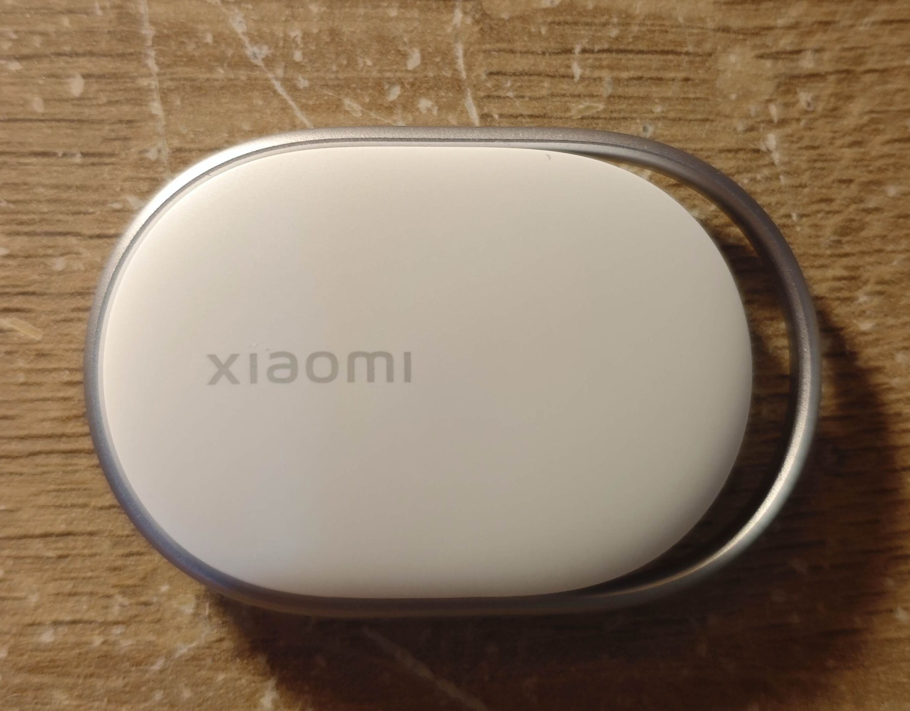
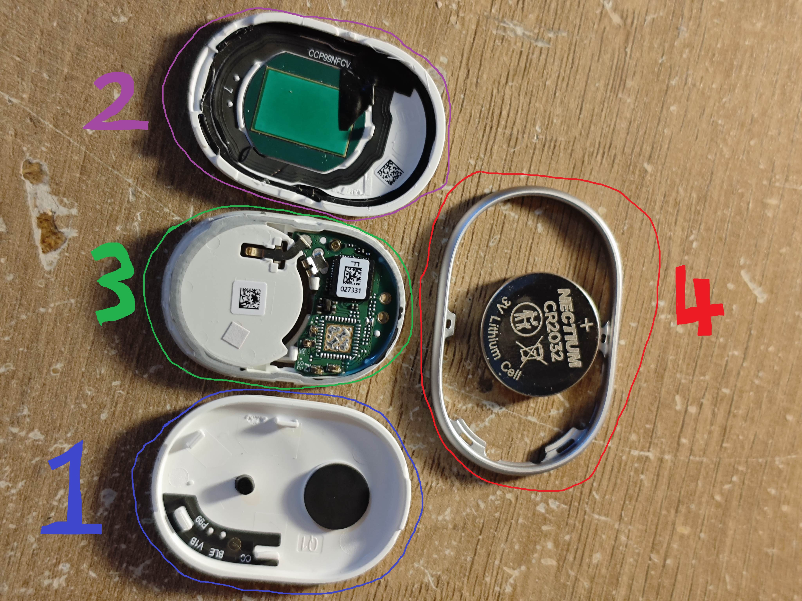
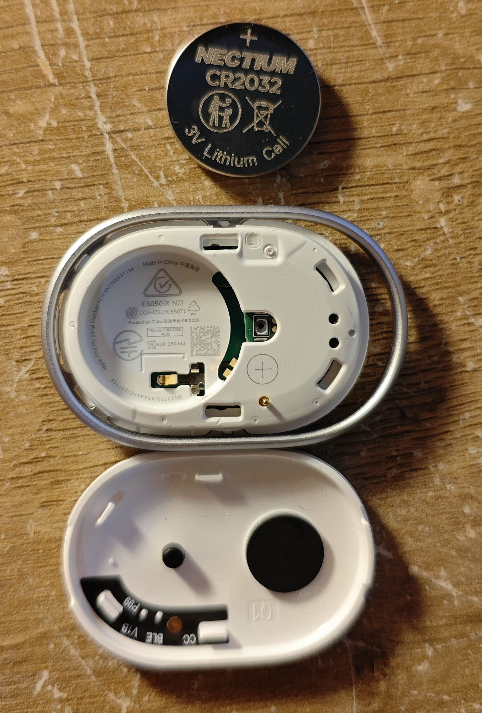
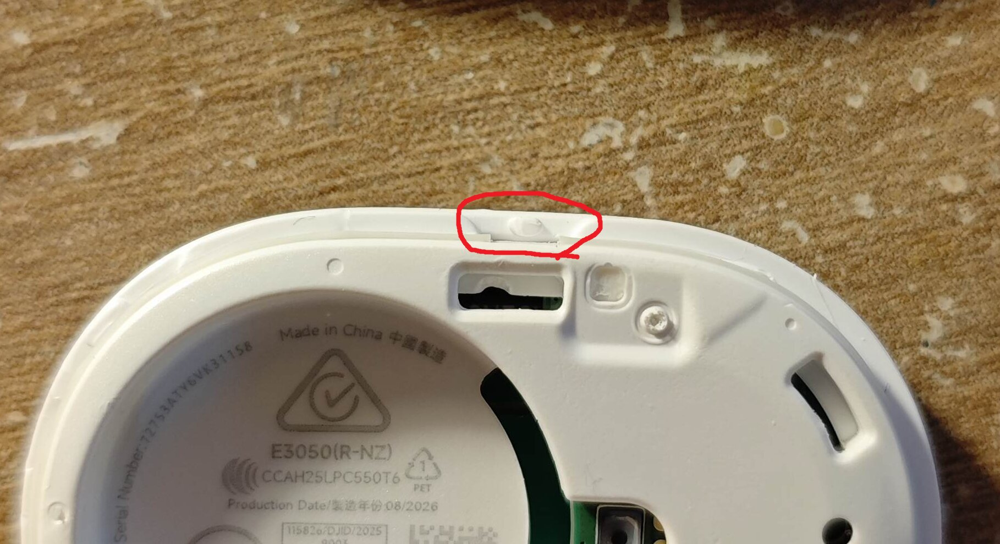
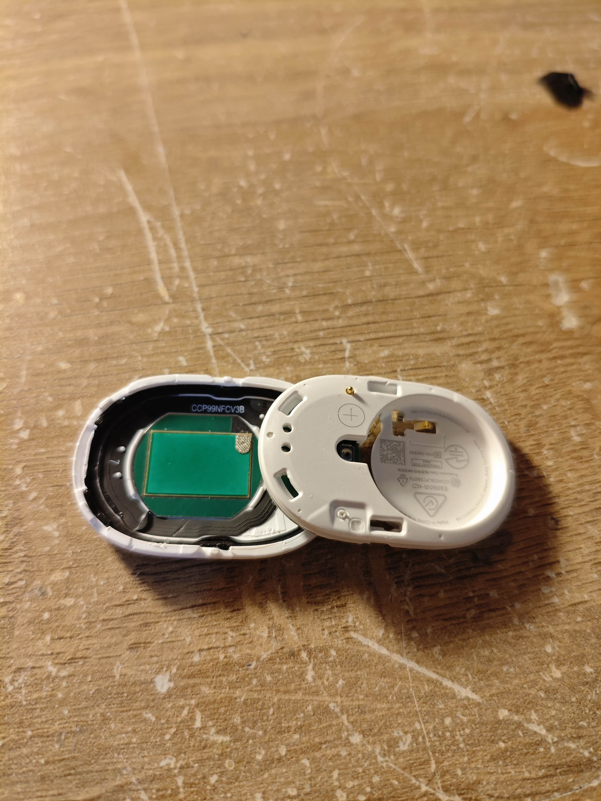
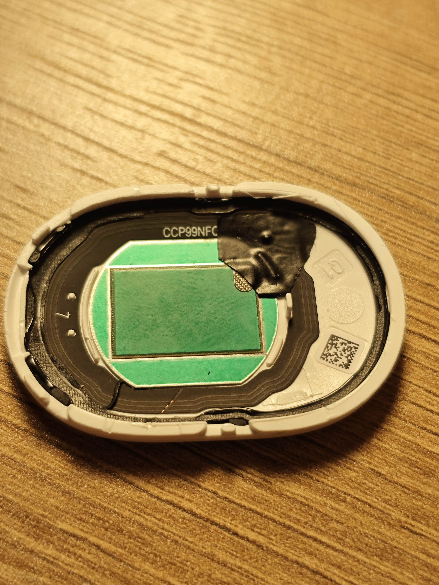
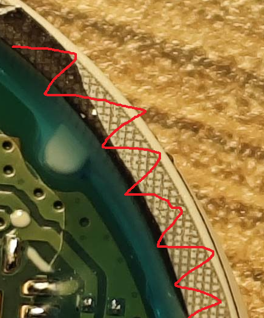
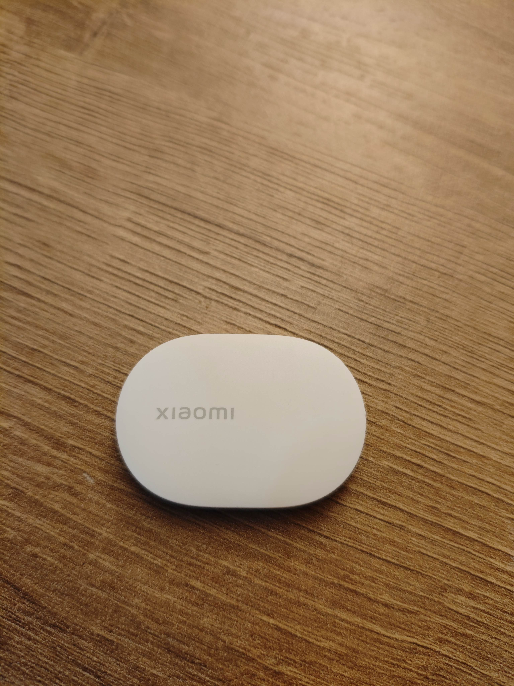

# xiaomi-tag-mute

Explaining how I managed to mute the speaker and turn off NFC on my Xiaomi Tag.

Disclaimer:
This guide is for informational and educational purposes only. This operation is obviously out of warranty.

## STEP 1: TEARDOWN
### Verification Test
Before going further, please test these functions:
- Press the hidden button where the Xiaomi text is; it should make a beep sound when you press it (you don't need to hold press).
- Bring the back of your phone close to the device; you should immediately receive a notification on your phone stating that NFC has been detected (if this is not working, look at your phone's NFC settings. Also, your phone may not have NFC, just google it).

There are mainly 4 parts:

1. **Front plate** (covering the battery, there's also part of the hidden button and Bluetooth mod)
2. **Back plate** (the speaker and NFC sensor are in this part)
3. **Mid case** (A large part that holds the battery, independent of the top and bottom plates)
4. **Gray circle** (An accessory that contains no circuitry and serves solely to hang the device somewhere. However, the device might lose its waterproof and dustproof properties if you don't use it.)

**Warning:**
Especially if you are using a metal object for prying, plastic can deform very easily.

You can see a gap on the right side of the tag to open the battery compartment. Just pry open the front plate with your finger or with a screwdriver.

After taking off the battery, it's going to look like this:

You can see the clips of the gray circle; try to set free some clips, then it will go off when you pull it from the hanging section.

**Warning for next step:**  
If you look closely, there's a white waterproof gasket at the intersection point of the back plate and mid case. It looks like there's no glue between the gasket and the back plate; it's just glued to the case. So, if you don't want to lose its waterproof property, you should be careful when opening it.

You can use this gap in the next step to open it.

The back plate and mid case are glued from the inside. You should heat the glue first. I simply use a 1200W hairdryer, hold it to the middle of the case for 10-15 seconds (it can blow away if you hold it to the sides), then quickly try to pry it open. If you can't take it apart in 10 seconds, heat it back up and try again.

If you managed to separate these parts, congratulations! You tore it down completely (or at least enough to reach NFC and the speaker).

## STEP 2: MODIFYING

As you can see, there are 2 pairs of pins (on the mid case) and their respective pads (on the back plate). The pink circled pair is the power path to the buzzer, and the red circled pair is NFC's power. If we simply block the path by adding an isolation layer between these pins and pads, the respective function will shut off.

These functions can work separately, so you can use it with the buzzer off and NFC on; buzzer on and NFC off; or both off. Just put electrical tape on the pads you want to shut off.

*A reference image: The NFC pads are completely covered with electrical tape. As for the buzzer, while the ground pad is covered, a portion of the positive (+) pad remains exposed; however, since the ground pin is not in contact with its pad, the circuit is not completed, and the function will not work.*

**Warning:**
Don't forget the pins in the mid case can puncture the isolation material. I recommend using two layers of tape.

After you finish isolating:
1. Simply put the battery back.
2. Close the front plate.
3. Press the back plate and mid case together with your hand.

At that point, if you closed the speaker function, the device will not make a sound when you press the hidden button. If you closed the NFC function, you shouldn't see a notice when you bring the phone to the device. 

If the function(s) are still on, look for a puncture on the tape. If it works the way you want, the next step is closing the parts back up.

## STEP 3: REINTEGRATION
You need to glue the back plate and mid case back together.

You can use super glue on the square-patterned area of the mid case. Next, attach the gray circle to its clips (if you do not like the gray circle or need to fit it into a tight space, you can skip this step; the version without the circle is shown below, though please note that it will likely lose its water-resistant property if used this way).

Then insert the battery and close the front plate.
